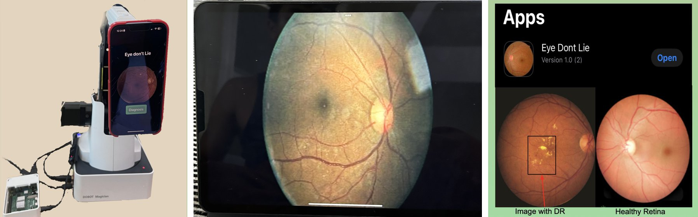
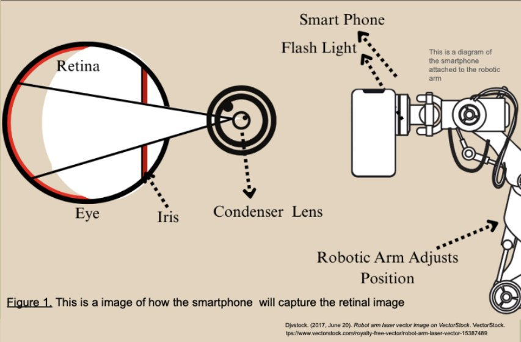

# Eye Don't Lie

**Real-time diabetic retinopathy screening on an iPhone, from a live camera feed, with a robotic-arm phone mount.**

Left: the app on an iPhone held by a Dobot Magician arm, Raspberry Pi for control. Middle: a public fundus image on a tablet screen, used as a test target. Right: the app on TestFlight, and what the model looks for (DR lesions vs a healthy retina), from the poster.

> *"He is demonstrating an app he created that uses the camera to diagnose an eye disease. It took first place in the state's middle school science fair."*
>
> Associated Press, via the [Christian Science Monitor](https://www.csmonitor.com/USA/Education/2024/0507/Florida-school-creative-curriculum-inspires) (May 7, 2024)

## What it does

Diabetic retinopathy is a leading cause of blindness in working-age adults, and it is treatable when it is caught early. The catch is screening: it needs a retinal camera and a specialist, and many diabetic patients don't get regular eye exams. I wanted to see how far a phone could get on its own: point the camera at the retina through a condenser lens, and have the phone classify what it sees, on the device, in real time.

I built this in 8th grade at A.D. Henderson University School.

## Highlights

| | |
|---|---|
| **Real-time, on-device** | Every camera frame goes through a Core ML model on the iPhone. No server, no upload, no internet needed |
| **Five-way grading** | Healthy, or DR stage 1 (early) through stage 4 (proliferative), shown as a plain-language message on screen |
| **Capture guidance** | A dedicated `Zoom_In` class detects a poorly framed image and tells the user *"Please move closer for better image quality"* |
| **Robotic-arm mount** | A Dobot Magician arm driven by a Raspberry Pi holds the phone and adjusts its position, so the capture distance is repeatable |
| **Shipped through TestFlight** | Installed on a real iPhone as *Eye Don't Lie* 1.0 (2) |
| **Recognition** | 1st place at the 2024 Florida State Middle School Science Fair; covered by the AP |

## How it works

Capture optics, from the science fair poster.

1. **Capture.** The phone's flash lights the retina through a condenser lens (the same idea as indirect ophthalmoscopy). The robotic arm holds the phone steady at the right distance.
2. **Classify.** `ContentView.swift` streams frames from `AVCaptureSession` straight into the bundled Core ML model.
3. **Guide or report.** If the frame is badly framed (`Zoom_In`), the app asks the user to move closer. Otherwise it shows the predicted stage (`DR_Healthy`, `DR_1` to `DR_4`).

## The model

An image classifier trained in Apple's **Create ML** on top of the **scenePrint** feature extractor, exported as a Core ML model and bundled in the app.

| Model | Images | Classes | Validation accuracy |
|---|---|---|---|
| `Images_2024_0509 1.mlmodel` (**used by the app**) | 297 | 6: `DR_Healthy`, `DR_1`–`DR_4`, `Zoom_In` | 60% (18 of 30) |
| `DR_Image_Classifer 1.mlmodel` (earlier) | 95 | 5: Healthy, stages one to four | 78% (7 of 9) |

Numbers come from the Create ML project files in this repo. See **Limitations** for what they do and don't mean.

**Training data** (`Images 2/`): 50 images per class for healthy and DR stages 1–4 (224×224, from a public Kaggle fundus dataset, numeric IDs only), plus 47 iPhone photos of fundus images shown on a screen for the `Zoom_In` class.

## Run it

1. Open `VideoContinuousImageDetection.xcodeproj` in Xcode and set your signing team.
2. Run on a physical iPhone (the simulator has no camera).
3. Tap **Start Analysis** and point the camera at a fundus image.

The trained model is bundled, so nothing needs training. To retrain, open `Images_2024_0509.mlproj` in Create ML and point it at `Images 2/`.

## Repo layout

| Path | What it is |
|---|---|
| `VideoContinuousImageDetection/ContentView.swift` | Camera capture, per-frame Core ML prediction, UI |
| `VideoContinuousImageDetection/*.mlmodel` | Trained Core ML models (the app uses `Images_2024_0509_1`) |
| `Images_2024_0509.mlproj` | Create ML project with training and validation metrics |
| `Images 2/` | Training images |
| `docs/A.Sahai_FY24_RoboticArm_RetinalImage.pdf` | Science fair poster |

## Recognition

- **1st place**, Florida State Middle School Science Fair, 2024
- Featured in an **Associated Press** story on A.D. Henderson's curriculum, republished by the [Christian Science Monitor](https://www.csmonitor.com/USA/Education/2024/0507/Florida-school-creative-curriculum-inspires), WLRN and VOA

## Limitations

- **Proof of concept, not a medical device.** No clinical testing; tested on public fundus images, mostly photographed off a screen.
- **Small validation set.** The app's model was validated on 30 images (5 per class). It is reliable on `Zoom_In` (5 of 5); DR-stage recall ranges from 2 of 5 to 3 of 5.
- **Arm code not included.** The Dobot and Raspberry Pi control code are not in this repo.
- **Not rebuilt since 2024.** Last built as TestFlight 1.0 (2).

## Credits

Built by Anik Sahai. Fundus images are from a public Kaggle dataset. Xcode file headers show the name of the shared family Mac account the project was created on.

## License

MIT © Anik Sahai, see [LICENSE](LICENSE).
