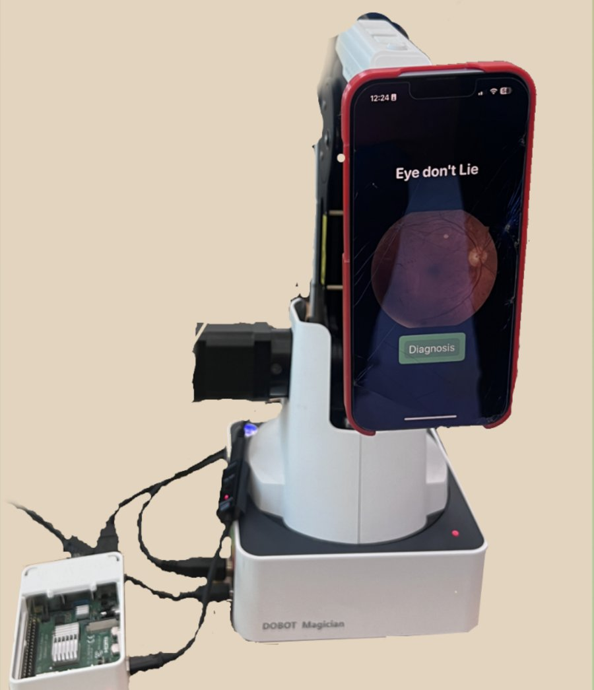

# Eye Don't Lie: diabetic retinopathy screening on a phone

An iPhone app that classifies retinal images from the live camera feed into healthy or one of four diabetic retinopathy (DR) stages, plus a robotic arm that holds the phone at a fixed distance. 8th-grade science fair project, 2024.

*The phone running the app on a Dobot Magician arm, with a Raspberry Pi for control (from the poster).*

## Status

| Part | State |
|---|---|
| iOS app (SwiftUI, AVFoundation, Core ML) | Classifies every camera frame and shows the label. Last built in 2024 (TestFlight 1.0 (2)); not rebuilt since |
| Classifier | Create ML image classifier, Apple scenePrint feature extractor |
| Robotic arm mount | Shown on the poster; the arm and Raspberry Pi code are not in this repo |
| Clinical testing | None. Tested only on public fundus images, mostly photographed off a laptop screen |

## Results

1st place, Florida state middle school science fair, 2024. Covered by the AP ([Christian Science Monitor, May 7, 2024](https://www.csmonitor.com/USA/Education/2024/0507/Florida-school-creative-curriculum-inspires)).

Model numbers, from the Create ML project files in this repo:

| Model | Images (incl. validation) | Classes | Validation accuracy |
|---|---|---|---|
| `Images_2024_0509 1.mlmodel` (used by the app) | 297 | 6: DR_Healthy, DR_1 to DR_4, Zoom_In | 60% (18 of 30) |
| `DR_Image_Classifer 1.mlmodel` (earlier) | 95 | 5: Healthy, stages one to four | 78% (7 of 9) |

The validation sets are tiny (5 images per class for the app's model), so these numbers are rough. Per class, the app's model is reliable only on `Zoom_In` (5 of 5); the DR stages range from 2 of 5 to 3 of 5 recall. Treat it as a proof of concept for phone capture.

## Data

`Images 2/` is the training set for the app's model:

- `DR_Healthy/`, `DR_1/` to `DR_4/`: 50 images each, 224x224, from a public Kaggle fundus dataset (file names follow its `<id>_<left|right>.jpeg` scheme). No patient information beyond those numeric IDs.
- `Zoom_In/`: 47 iPhone photos of fundus images shown on a laptop screen, used as a "move closer" class so the app can tell the user to reposition.

## Running

Open `VideoContinuousImageDetection.xcodeproj` in Xcode, set your signing team, and run on an iPhone (the camera is needed, so the simulator won't work). Tap Start Analysis and point the camera at a fundus image. The model is bundled; nothing needs to be trained. To retrain, open `Images_2024_0509.mlproj` in Create ML and point the data source at `Images 2/`.

## Layout

| Path | What it is |
|---|---|
| `VideoContinuousImageDetection/ContentView.swift` | camera capture, per-frame Core ML prediction, UI |
| `VideoContinuousImageDetection/*.mlmodel` | three trained Core ML models; the app uses `Images_2024_0509_1` |
| `Images_2024_0509.mlproj`, `VideoContinuousImageDetection/DR_Image_Classifer.mlproj` | Create ML projects with training metrics |
| `Images 2/` | training images |
| `docs/A.Sahai_FY24_RoboticArm_RetinalImage.pdf` | science fair poster |

## Credits

Anik Sahai, A.D. Henderson University School, 2024. The Swift file headers credit Amit Gupta and Danika Gupta, who created the original Xcode project. Fundus images are from a public Kaggle dataset.
